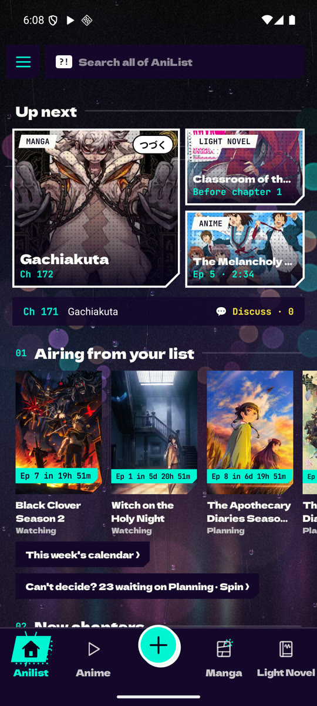
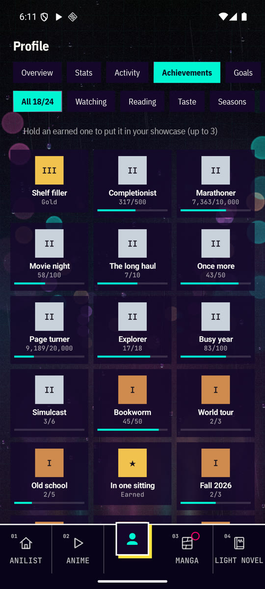
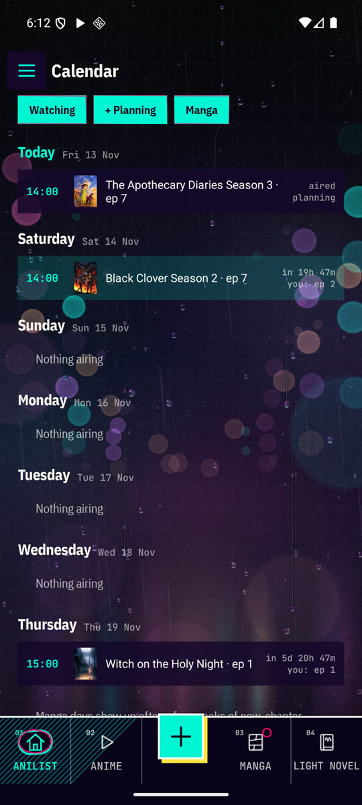
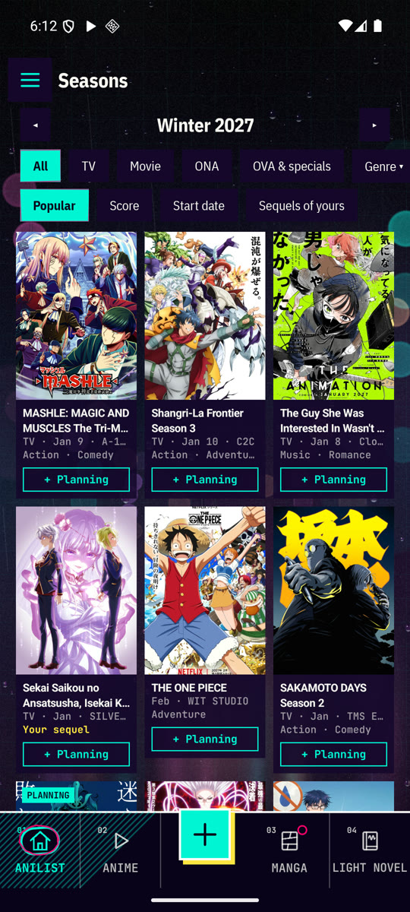
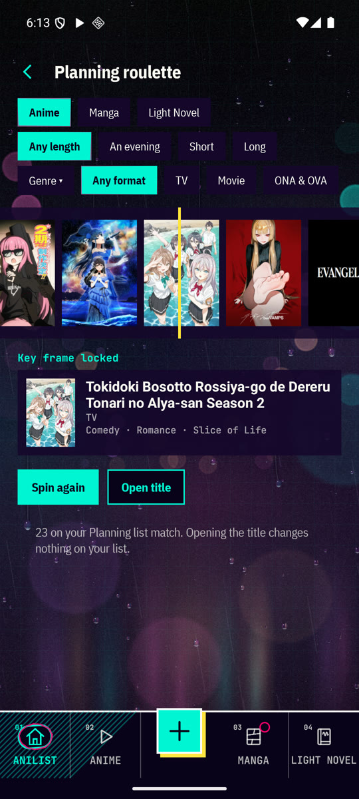
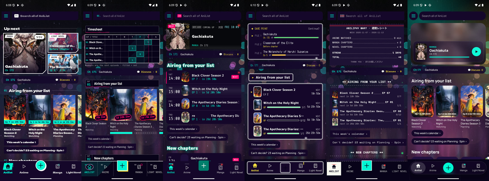

# aniliphy

An Android **AniList client** that also plays anime and reads manga and light
novels, with your progress synced to [AniList](https://anilist.co). Free, open
source, no ads and no server of its own: you log in with AniList and the app
talks straight to it. It is the phone sibling of
[anilixy](https://github.com/lexviy/anilixy), the terminal app, written in
Kotlin with Jetpack Compose.

<p>
  
  
  
  
  
</p>
<p></p>

**[Download the latest APK](https://github.com/lexviy/aniliphy/releases/latest)**

## Features

### AniList

- **Lists**: anime, manga and light novels, with a full entry editor, notes,
  custom lists, a quick menu on long-press and removing with Undo.
  **Franchises** are grouped into one card, with the watch order (movies and
  OVAs too) and "+ Planning" for what's missing.
- **Profile**: banner and bio, stats in tabs (overview, genres and tags,
  people, distributions), an activity heatmap by day with streaks and "on this
  day", **achievements** worked out from your lists (some hidden, some
  seasonal) with a showcase, **goals** like "50 anime this year" and a yearly
  **Wrapped**.
- **Social**: the feed of who you follow, with likes and replies; find people
  and follow them; friend profiles with a compatibility score and a list
  comparison; "friends with this" on every title.
- **Sharing**: anilist.co links, or a picture drawn on the phone in your look,
  for titles, your profile, achievements, stats and Wrapped. anilist.co links
  open in the app.
- **Forum**: recent threads, categories, threads about your titles, reading,
  replying, liking and posting, with spoilers hidden until tapped, and the
  discussion of each episode one tap away.
- **Inbox**: your AniList notifications, with the unread count on the bar and
  a phone notification for new replies, mentions, messages and follows.
- **Calendar**: the next 7 days of what airs from your list, with countdowns,
  and the days your manga usually get new chapters.
- **Seasons**: any season's anime in a grid, with filters, "sequels of yours"
  and one-tap "+ Planning" (with Undo).
- **Planning roulette**: can't decide? It spins your Planning list, with
  filters for length, genre and format.
- **Spoiler-free mode**: hides names of episodes and chapters you haven't
  reached and synopses of sequels to what you haven't finished, everywhere or
  per title.
- Search for anime, manga, characters, staff and studios; recommendations;
  a guest mode that works without an account.

### Watching and reading

- **Anime**: *Watch* opens the next episode after your AniList progress, or
  carries on where you stopped. Its own player (Media3) has subtitles,
  quality, Sub/Dub, skipping of openings and endings, autoplay, gestures,
  picture-in-picture and sound in the background. Episodes can be downloaded.
- **Manga**: a reader with page, two-page and webtoon modes, and chapters
  saved for offline reading.
- **Light novels**: an EPUB/PDF reader for the books in a folder you choose,
  counting chapters for your AniList progress.
- **New episodes and chapters**: checked in the background about every half
  hour, with a notification for each.
- **Extensions**: episodes and chapters come from extensions you install
  yourself, including Mihon and Aniyomi ones (see below). The app doesn't come
  with any.

### Looks

Ten complete looks (Tankōbon, Modern, Genga, Bunko, Shin'ya, JRPG, Eki,
Konbini, Stamp rally and Glass). Each changes the fonts, shapes, animated
background, bottom bar, sounds, vibration and even the wording, and the
home-screen widget follows it. The bottom bar comes in three styles and you
choose which tabs stay on it.

### Sync

AniList counts sync through AniList. Through a private GitHub gist, the place
you stopped (episode and minute, chapter and page, sources picked) is shared
with anilixy, and your goals, achievement showcase and activity with your
other phones.

## Requirements

- Android 8.0 (API 26) or newer.
- An AniList account, or the guest mode.

## Installing

The app isn't on the Play Store. Download the APK from the
[releases](https://github.com/lexviy/aniliphy/releases/latest), open it on
the phone and allow installing apps from that source when Android asks (only
the first time). New versions install over the old one and keep your data.

## Building

You need JDK 21 and the Android SDK (platform 37 and its build tools).

```sh
./gradlew assembleDebug        # the APK lands in app/build/outputs/apk/debug/
./gradlew installDebug         # or straight onto a phone connected by adb
./gradlew testDebugUnitTest    # the unit tests
./gradlew lintDebug            # the lint checks
scripts/look-shots.sh          # a screenshot of every tab in every look, into build/look-shots/
```

`scripts/look-shots.sh` needs a phone or emulator connected by adb with the app
set up. It only opens the tabs, without tapping anything, and puts the look
and tab back as they were.

### Release APK

`./gradlew assembleRelease` makes a smaller, faster APK in
`app/build/outputs/apk/release/`. It is signed with the key named in
`keystore.properties` at the root of the project, which stays out of git:

```properties
storeFile=/path/to/release.jks
storePassword=...
keyAlias=aniliphy
keyPassword=...
```

Keep the keystore and that file backed up: a new APK only installs over the old
one when both are signed with the same key. Raise `aniliphy.versionCode` (and
`aniliphy.versionName`) in `gradle.properties` for every APK you hand out:
Android refuses to install an APK over one with the same or a higher code.

## First run: logging in to AniList

1. Create an app at [anilist.co/settings/developer](https://anilist.co/settings/developer),
   with `https://anilist.co/api/v2/oauth/pin` as its Redirect URL.
2. Paste its Client ID in the app and open the token link.
3. Authorize, copy the token and paste it back in the app.

The token stays on the phone. Or pick *Continue as guest*: you can browse,
watch and read, with the progress kept on the phone only.

## Using it

The bottom bar holds the tabs you pin (AniList, Anime, Manga and Light Novel
at first) and a middle button for the rest: Profile, Social, Forum, Inbox and
Settings. The AniList tab's menu has Home, your lists, Calendar, Seasons,
search and more. *Settings → Guide* explains each part: how episodes and chapters are chosen,
the player and readers, downloads, notifications and where things are kept.

The light novels folder is chosen in the Light Novel tab or in
*Settings → Light Novel settings*. Keep the series name in the file names,
for example `Classroom of the Elite Vol. 1.epub`, so books are matched to
their titles.

## Extensions

aniliphy is a player and a reader: it doesn't know any site. The sources come
from extensions, which are APKs with no screen that the app finds on the phone
and loads. *Settings → Extensions* lists the installed ones and the sources
each brings, and *Preferred source* in the Anime and Manga settings picks the
one tried first. Installing, updating or removing an extension shows up right
away, without restarting the app.

An extension's code runs inside aniliphy, so only extensions signed with the
same key as the app are loaded by themselves. Any other shows up as not
trusted, with a *Trust* button that shows its key first.

Progress is kept by the app, not by the extensions: removing one keeps your
place, and downloaded episodes and chapters still open without it.

### Mihon and Aniyomi extensions

Extensions made for Mihon (manga, extension library 1.4 or 1.6) and Aniyomi
(anime, extension library 14, 16 or 17) can be loaded too: install their APK like
any other and trust it. aniliphy carries the classes they are built against, in
the [`tachi-compat`](tachi-compat) module, adapted from those apps under the
Apache License 2.0. When one extension brings a site in many languages, only
English, the phone's language and the multi-language ones are listed.

Their sources are also listed under *Browse* in *Settings → Extensions*, where
each one can be browsed (popular, latest, search and the source's own filters)
and, when it has them, its settings changed. Tapping a title there asks which
AniList entry it is, then opens that entry with the source already picked.
Titles already on your list are marked, and offer their AniList page and
downloads of several episodes or chapters at once.
Episodes they give as HLS, DASH or a plain video file can all be downloaded,
and when the sound comes apart from the picture, the track in the language of
the Sub or Dub picked plays (and is saved) with it.
What aniliphy doesn't do for them: local video servers and torrents.

*Search all sources*, at the top of *Browse*, runs one search on every anime
and manga source at once, each in its own row.

*Import a Mihon or Aniyomi backup* reads a `.tachibk` file and gives each title
that was tracked on AniList there the same source and address here, when that
source is installed. It shows what it would do before changing anything, and
leaves alone the titles that already open with a source.

### Making one

An extension is an Android app that depends on the `source-api` module of this
project as `compileOnly`, and declares in its manifest:

```xml
<uses-feature android:name="aniliphy.extension" android:required="true" />
<application android:hasCode="true" android:label="My sources">
    <meta-data android:name="aniliphy.extension.class" android:value=".MySources" />
    <meta-data android:name="aniliphy.extension.api" android:value="1" />
</application>
```

`MySources` implements `Extension`, which hands the app lists of `AnimeSite`,
`MangaSite` and `NovelSite`. Each source has an `id` that is saved with
progress, so it must never change, and makes its requests through the
`SourceServices` it is given, so cookies and robot checks keep working. OkHttp,
Jsoup, kotlinx.serialization and Kotlin can be `compileOnly` too: at runtime
the extension uses the app's copies. The interfaces are documented in
[`source-api`](source-api/src/main/kotlin/com/aniliphy/source).

## Syncing with anilixy

AniList counts already sync through AniList. *Settings → Sync with anilixy*
also keeps the same place in both apps: the episode and the minute, the manga
chapter and page, the light novel chapter and the sources picked.

1. Press *Make a token on GitHub*: it opens GitHub with only the **gist**
   permission ticked. Make the token and copy it.
2. Paste it here and in anilixy (*Settings → Sync*), then press *Sync now*.

The first sync makes a private gist named `anilixy-sync.json`, and the other
app finds it by that name, so the same token is all either needs. For each
title the newer place wins, and nothing is deleted. With *Also sync your
profile* on, the phone also keeps its goals, achievement showcase, celebrated
moments and activity days in a second file of the same gist,
`aniliphy-profile.json`, which anilixy leaves alone. With *Sync on opening and
leaving* on, the phone syncs when the app opens and when you leave it. The
token is kept apart from the settings, so exporting them never puts it in a
file. *Forget the token* stops syncing and leaves the gist on GitHub.

## Where your data lives

Everything stays in the app's private storage: the login, settings, progress,
saved sources, downloads and caches. *Settings → Storage* shows the space
used, lists the downloads to delete them one by one, clears the cache, exports
or imports the settings and resets the app.

When a site answers with a "checking you're not a robot" page, the app opens
it in a small browser window to be passed by hand, then keeps that site's
cookie for its own requests. Android backups are turned off for the app, so the AniList
token isn't copied off the phone.

## Disclaimer

aniliphy doesn't host or link to any content, and it doesn't come with any
source: it is an AniList client with a player and readers. What it plays or
shows depends entirely on the extensions you choose to install, which are not
part of this project. You are responsible for what you install and for
following the laws of your country. Support the official releases when you can.

## License

[GNU Affero General Public License v3.0](LICENSE).
